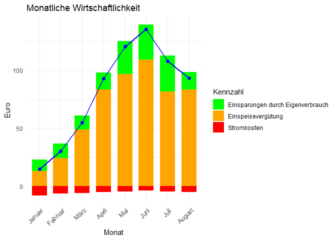
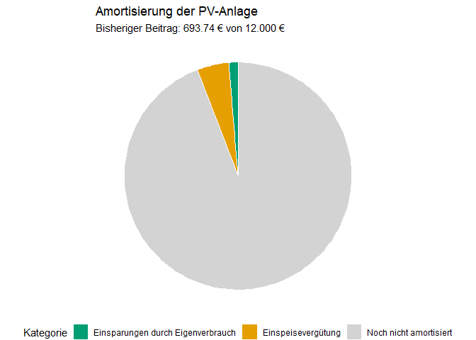

Analyse einer Photovoltaikanlage
================

## 1. Datenimport

``` r
zip_dateien <- list.files(
  "../martin-raden/PV",
  pattern = "\\.zip$",
  full.names = TRUE
)
```

## 2. Alle CSV-Dateien zusammenführen

``` r
daten_liste <- lapply(zip_dateien, function(zip_datei) {

  csv_name <- unzip(zip_datei, list = TRUE)$Name[1]

  daten <- read.csv2(
    file = unz(zip_datei, csv_name),
    header = FALSE,
    skip = 1,
    col.names = c(
      "Datum",
      "Netzeinspeisung [kWh]",
      "Netzbezug [kWh]",
      "Speicherung [kWh]",
      "PV Ertrag [kWh]",
      "Leer"
),
    fill = TRUE,
    check.names = FALSE
  )

  daten <- daten[, 1:5]

  return(daten)
})

daten_alle <- dplyr::bind_rows(daten_liste)
```

## 3. Daten prüfen

``` r
daten_alle$Datum <- as.Date(
  daten_alle$Datum,
  format = "%d.%m.%Y"
)

daten_2025 <- dplyr::filter(
  daten_alle,
  !is.na(Datum),
  format(Datum, "%Y") == "2025"
)

nrow(daten_2025)
```

    ## [1] 250

### Fehlende Werte

``` r
colSums(is.na(daten_2025))
```

    ##                 Datum Netzeinspeisung [kWh]       Netzbezug [kWh] 
    ##                     0                     0                     0 
    ##     Speicherung [kWh]       PV Ertrag [kWh] 
    ##                     0                     0

### Doppelte Einträge

``` r
sum(duplicated(daten_2025$Datum))
```

    ## [1] 9

## 4. Datenbereinigung

Fehlende Werte werden mithilfe von `complete.cases()` überprüft.
Unvollständige Datensätze werden entfernt, da sich die fehlenden
Messwerte nicht zuverlässig ergänzen lassen.

Bei mehrfach vorhandenen Datumsangaben wird jeweils der Datensatz mit
dem höchsten PV-Ertrag behalten.

``` r
library(dplyr)
```

    ## 
    ## Attache Paket: 'dplyr'

    ## Die folgenden Objekte sind maskiert von 'package:stats':
    ## 
    ##     filter, lag

    ## Die folgenden Objekte sind maskiert von 'package:base':
    ## 
    ##     intersect, setdiff, setequal, union

``` r
daten_vollstaendig <- daten_2025[
  complete.cases(daten_2025),
]

daten_bereinigt <- daten_vollstaendig %>%
  arrange(Datum, desc(`PV Ertrag [kWh]`)) %>%
  distinct(Datum, .keep_all = TRUE) %>%
  arrange(Datum)

nrow(daten_bereinigt)
```

    ## [1] 241

``` r
sum(duplicated(daten_bereinigt$Datum))
```

    ## [1] 0

### Ergebnis der Datenprüfung und Bereinigung

Insgesamt wurden 251 Datensätze aus den ZIP-Dateien eingelesen.

Davon wurden 1 Datensätze ausgeschlossen, da sie nicht zum Jahr 2025
gehören oder ein ungültiges Datum enthalten.

Bei der Prüfung auf fehlende Werte wurden 0 unvollständige Datensätze
festgestellt.

Doppelte Datumseinträge wurden entfernt. Dabei wurde jeweils der
Datensatz mit dem höchsten PV-Ertrag behalten.

Insgesamt wurden 9 doppelte Einträge entfernt.

Nach der Bereinigung verbleiben 241 Datensätze für die weitere Analyse.

## 5. Datenaufbereitung

``` r
daten_bereinigt <- daten_bereinigt %>%
  mutate(
    `Eigenverbrauch [kWh]` =
      `PV Ertrag [kWh]` -
      `Netzeinspeisung [kWh]` -
      `Speicherung [kWh]`,

    `Gesamtverbrauch [kWh]` =
      `Eigenverbrauch [kWh]` +
      `Netzbezug [kWh]`,

    `Eigenverbrauchsanteil [%]` =
      ifelse(
        `Gesamtverbrauch [kWh]` > 0,
        `Eigenverbrauch [kWh]` /
          `Gesamtverbrauch [kWh]` * 100,
        NA_real_
      )
  ) %>%
  arrange(Datum)
```

## 6. Monatliche Kennzahlen

``` r
monatsnamen <- c(
  "Januar", "Februar", "März", "April",
  "Mai", "Juni", "Juli", "August",
  "September", "Oktober", "November",
  "Dezember"
)

energie_spalten <- c(
  "PV Ertrag [kWh]",
  "Eigenverbrauch [kWh]",
  "Gesamtverbrauch [kWh]",
  "Netzeinspeisung [kWh]",
  "Netzbezug [kWh]"
)

monatswerte <- daten_bereinigt %>%
  mutate(
    Monatsnummer = as.integer(format(Datum, "%m"))
  ) %>%
  group_by(Monatsnummer) %>%
  summarise(
    across(all_of(energie_spalten), sum),
    .groups = "drop"
  ) %>%
  arrange(Monatsnummer) %>%
  mutate(
    Monat = monatsnamen[Monatsnummer]
  )
```

## 7. Wirtschaftlichkeit der PV-Anlage

Für die Berechnung der Stromkosten wird ein Strompreis von 0,30 €/kWh
angenommen. Die Einspeisevergütung beträgt 0,08 €/kWh.

``` r
monatswerte <- monatswerte %>%
  mutate(
    `Stromkosten [€]` =
      `Netzbezug [kWh]` * 0.30,

    `Einspeisevergütung [€]` =
      `Netzeinspeisung [kWh]` * 0.08,

    `Einsparungen durch Eigenverbrauch [€]` =
      `Eigenverbrauch [kWh]` * 0.30,

    `Gesamtwirtschaftlichkeit [€]` =
      `Einsparungen durch Eigenverbrauch [€]` +
      `Einspeisevergütung [€]` -
      `Stromkosten [€]`
  )

knitr::kable(
  monatswerte %>%
    select(-Monatsnummer) %>%
    select(Monat, everything()),
  format = "pipe",
  digits = 2,
  row.names = FALSE
)
```

| Monat | PV Ertrag \[kWh\] | Eigenverbrauch \[kWh\] | Gesamtverbrauch \[kWh\] | Netzeinspeisung \[kWh\] | Netzbezug \[kWh\] | Stromkosten \[€\] | Einspeisevergütung \[€\] | Einsparungen durch Eigenverbrauch \[€\] | Gesamtwirtschaftlichkeit \[€\] |
|:---|---:|---:|---:|---:|---:|---:|---:|---:|---:|
| Januar | 313.43 | 33.97 | 61.07 | 160.42 | 27.10 | 8.13 | 12.83 | 10.19 | 14.89 |
| Februar | 436.24 | 41.92 | 63.64 | 301.50 | 21.72 | 6.52 | 24.12 | 12.58 | 30.18 |
| März | 728.74 | 40.43 | 61.06 | 611.56 | 20.63 | 6.19 | 48.92 | 12.13 | 54.86 |
| April | 1145.89 | 48.96 | 65.89 | 1040.88 | 16.93 | 5.08 | 83.27 | 14.69 | 92.88 |
| Mai | 1343.54 | 94.70 | 109.63 | 1206.39 | 14.93 | 4.48 | 96.51 | 28.41 | 120.44 |
| Juni | 1500.56 | 99.88 | 112.46 | 1366.43 | 12.58 | 3.77 | 109.31 | 29.96 | 135.50 |
| Juli | 1186.49 | 102.94 | 118.76 | 1020.63 | 15.82 | 4.75 | 81.65 | 30.88 | 107.79 |
| August | 1154.59 | 49.48 | 66.55 | 1042.92 | 17.07 | 5.12 | 83.43 | 14.84 | 93.16 |

## 8. Monatliche Wirtschaftlichkeit visualisieren

``` r
library(ggplot2)

positive_werte <- data.frame(
  Monat = rep(monatswerte$Monat, 2),

  Art = rep(
    c("Einsparungen durch Eigenverbrauch", "Einspeisevergütung"),
    each = nrow(monatswerte)
  ),

  Betrag = c(
    monatswerte$`Einsparungen durch Eigenverbrauch [€]`,
    monatswerte$`Einspeisevergütung [€]`
  )
)

positive_werte$Monat <- factor(
  positive_werte$Monat,
  levels = monatsnamen
)

diagramm_monate <- monatswerte %>%
  mutate(
    Monat = factor(Monat, levels = monatsnamen)
  )

ggplot() +
  geom_col(
    data = positive_werte,
    aes(x = Monat, y = Betrag, fill = Art),
    width = 0.7
  ) +
  geom_col(
    data = diagramm_monate,
    aes(
      x = Monat,
      y = -`Stromkosten [€]`,
      fill = "Stromkosten"
    ),
    width = 0.7
  ) +
  geom_line(
    data = diagramm_monate,
    aes(
      x = Monat,
      y = `Gesamtwirtschaftlichkeit [€]`,
      group = 1
    ),
    color = "blue",
    linewidth = 1
  ) +
  geom_point(
    data = diagramm_monate,
    aes(
      x = Monat,
      y = `Gesamtwirtschaftlichkeit [€]`
    ),
    color = "blue",
    size = 2
  ) +
  scale_fill_manual(
    values = c(
      "Einsparungen durch Eigenverbrauch" = "green",
      "Einspeisevergütung" = "orange",
      "Stromkosten" = "red"
    )
  ) +
  labs(
    title = "Monatliche Wirtschaftlichkeit",
    x = "Monat",
    y = "Euro",
    fill = "Kennzahl"
  ) +
  theme_minimal() +
  theme(
    axis.text.x = element_text(
      angle = 45,
      hjust = 1
    )
  )
```

<!-- -->

## 9. Jahresübersicht

Die folgenden Kennzahlen beziehen sich auf die 241 vorhandenen Tage aus
8 Monaten des Jahres 2025.

Da nicht für das gesamte Jahr Daten vorliegen, stellen die Ergebnisse
keine vollständige Jahresbilanz dar.

``` r
jahres_einsparungen <- sum(
  daten_bereinigt$`Eigenverbrauch [kWh]`
) * 0.30

jahres_verguetung <- sum(
  daten_bereinigt$`Netzeinspeisung [kWh]`
) * 0.08

amortisierung <- jahres_einsparungen +
  jahres_verguetung

durchschnitt_netz <- mean(
  daten_bereinigt$`Netzbezug [kWh]`
)

standardabweichung_netz <- sd(
  daten_bereinigt$`Netzbezug [kWh]`
)

tage_speicher <- mean(
  daten_bereinigt$`Speicherung [kWh]` < 0.5
) * 100

tage_hoher_netzbezug <- mean(
  daten_bereinigt$`Netzbezug [kWh]` >
    (durchschnitt_netz + standardabweichung_netz)
) * 100

jahresuebersicht <- data.frame(
  Kennzahl = c(
    "Amortisierung [€]",
    "Durchschnittlicher Netzbezug [kWh/Tag]",
    "Tage mit vollem Speicher [%]",
    "Tage mit überdurchschnittlichem Netzbezug [%]"
  ),

  Wert = c(
    amortisierung,
    durchschnitt_netz,
    tage_speicher,
    tage_hoher_netzbezug
  )
)

knitr::kable(
  jahresuebersicht,
  format = "pipe",
  digits = 2,
  row.names = FALSE
)
```

| Kennzahl                                        |   Wert |
|:------------------------------------------------|-------:|
| Amortisierung \[€\]                             | 693.74 |
| Durchschnittlicher Netzbezug \[kWh/Tag\]        |   0.61 |
| Tage mit vollem Speicher \[%\]                  |   7.05 |
| Tage mit überdurchschnittlichem Netzbezug \[%\] |  17.84 |

## 10. Amortisierung der Photovoltaikanlage

Die Gesamtinvestition in die Photovoltaikanlage beträgt 12.000 Euro. Das
folgende Tortendiagramm zeigt, welcher Anteil der Investition bereits
durch Eigenverbrauch und Einspeisevergütung erwirtschaftet wurde.

``` r
investition <- 12000

restbetrag <- max(
  investition - amortisierung,
  0
)

tortendaten <- data.frame(
  Kategorie = c(
    "Einsparungen durch Eigenverbrauch",
    "Einspeisevergütung",
    "Noch nicht amortisiert"
  ),

  Betrag = c(
    jahres_einsparungen,
    jahres_verguetung,
    restbetrag
  )
)

ggplot(
  tortendaten,
  aes(
    x = "",
    y = Betrag,
    fill = Kategorie
  )
) +
  geom_col(
    width = 1,
    color = "white"
  ) +
  coord_polar(theta = "y") +
  scale_fill_manual(
    values = c(
      "Einsparungen durch Eigenverbrauch" = "#009E73",
      "Einspeisevergütung" = "#E69F00",
      "Noch nicht amortisiert" = "#D3D3D3"
    )
  ) +
  labs(
    title = "Amortisierung der PV-Anlage",
    subtitle = paste(
      "Bisheriger Beitrag:",
      round(amortisierung, 2),
      "€ von 12.000 €"
    ),
    fill = "Kategorie"
  ) +
  theme_void() +
  theme(
    legend.position = "bottom"
  )
```

<!-- -->

Der bisherige Beitrag zur Amortisierung beträgt 5.78 % der gesamten
Investitionskosten.
