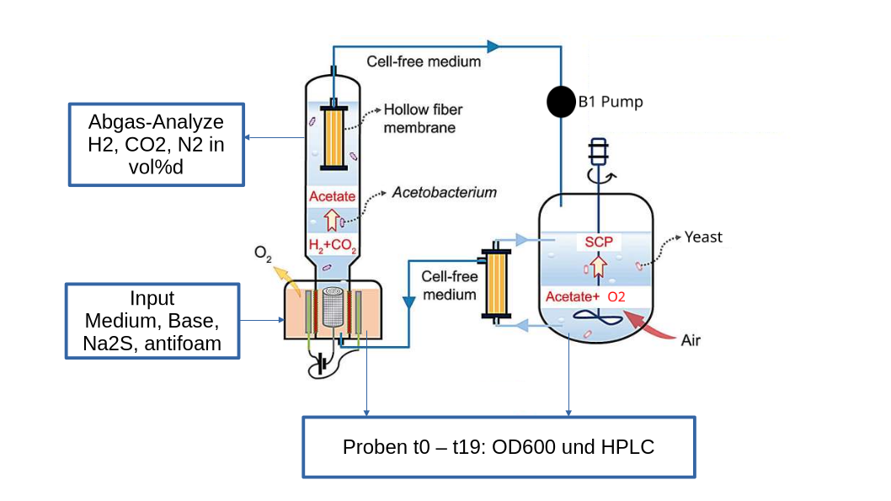
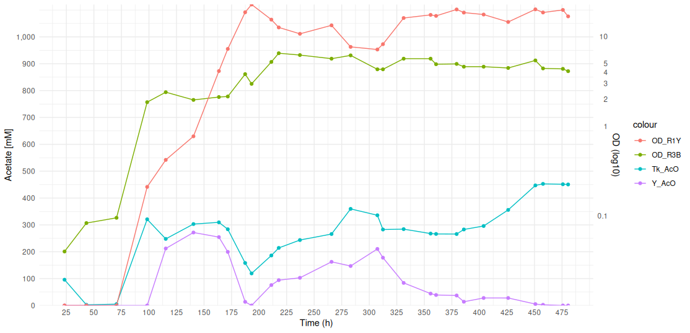

# Analyse eines 2 Reaktorsystems

In einem Biotechnologie Labor wird ein Reaktorsystem getestet, welches es ermöglicht aus Strom und CO2, Proteine herzustellen.
Dies ist interessant, da es eine Möglichkeit bietet, CO2 in wertvolle Produkte wie Proteine also Nahrung umzuwandeln. 
Dadurch können nicht nur auf sehr kleinenm Raum Lebensmittel hergestellt werden, sondern auch CO2 aus der Luft entfernt werden.
Es ist jedoch wichtig das diese Methode auch mit anderen Wegen der Proteinherstellung konkurrieren kann, da es sonst nicht wirtschaftlich ist und auch von der Industrie nicht umgesetzt wird.

In diesem Experiment ging es hauptsächlich darum die Essigsäureproduktion zu maximieren.
Diese Analyse soll nun den Wissenschaftlern im Labor helfen die Daten des Reaktorsystems zu analysieren und die Effizienz der Essigsäureproduktion zu bewerten.
Dabei werden verschiedene Messwerte aus unterschiedlichen Messgeräten zusammengeführt und ausgewertet.

## Das Reaktorsystem
Das Reaktorsystem besteht aus 2 Bioreaktoren die hintereinander geschalten sind. 
Im ersten Reaktor wird CO2 und Wasserstoff unter Druck und bei 60°C von einem Bakterium in Essigsäure umgewandelt. Im zweiten Reaktor wird die Essigsäure von Hefe gegessen.
Das Endprodukt ist die Biomasse der Hefe, welche Proteine enthält.

Es gibt eine wichtige Pumpe B1 welche die Essigsäure vom ersten Reaktor in den zweiten Reaktor pumpt.
Die Essigsäurekonzentration in den Reaktoren hängt von unterschiedlichen Parametern ab, wie die Pumprate von B1, die Produktionsrate und der Verdünnungsrate.

Um zu verfolgen was im Reaktor passiert, werden verschiedenste Messgeräte eingesetzt;
- Messgeräte am Reaktor selbst
- 1x pro Tag HPLC (High Performance Liquid Chromatography) zur bestimmung der Essigsäurekonzentration 
- 1x pro Tag OD (Optical Density) Messung zur bestimmung der Biomassekonzentration
- Automatische Messung der Gaszusammensetzung (CO2, H2, O2) im Reaktor durch GC (Gas Chromatography)

Ziel is diese Messwerte zusammenzuführen und die Effizienz der Essigsäureproduktion zu bestimmen.
Das wird realsierte in dem vier Werte ausgerechnet werden müssen:
- Den Gaseverbrauch vom Bakteriellen Reaktor 
- Die Essigsäureproduktion vom Bakteriellen Reaktor
- Wie viel vom zugeführten Kohlenstoff in Essigsäure umgewandelt wird
- Wie effizient die Hefe die Essigsäure in Biomasse umwandelt

Die Stichometrie der Acetogenesis ist wichtig für die später Berechnung:

$$
4\,H_2 + 2\,CO_2 \rightarrow CH_3COOH + 2\,H_2O
$$

## Die Daten
Es gibt 4 verschieden Quellen:
- Messgeräte am Reaktor selbst -> als einzelne CSV Datei pro Reaktor
- GC Messungen -> 15 Sartorius 2/analysis/datein.csv
- HPLC Messungen -> eine .txt Datei mit Proben von beiden Reaktoren. Gemessen wird die Formate- und Essigsäurekonzentration 
- OD Messungen -> ein excel sheet mit proben von beiden Reaktoren. Manuelle erstellt vom Wissenschaftler. Gemessen wird die Biomassekonzentration

Für die GC-Messung befindet sich pro Tag eine oder mehrere CSV Dateinen im Ordner.
Die HPLC Messung erfasst 2 Komponenten, hier sollte nur die Essigsäurekonzentration (Acetate) betrachtet werden.

Fünf Datenquellen müssen auf einer gemeinsamen Zeitachse zusammengeführt werden. Alle Daten wurden von mir während eines Praktikum erstellt und zum Zweck diese Kurses modifiziert.
Alle Daten sind in eine [Nextcloud-Ordner](https://uni-bonn.sciebo.de/s/AycWdxgCYws5mZY) zu finden unter folgendem Link: https://uni-bonn.sciebo.de/s/AycWdxgCYws5mZY

| Datei / Ordner | Inhalt | Format |
| --- | --- | --- |
| `15 Sartorius 3/analysis/*.csv` | Abgaszusammensetzung von R3 (*T. kivui*), ein oder mehere Datei pro Tag | CSV, `,` |
| `Run3_t0t19.txt.txt` | HPLC-Ergebnisse der Proben t0 bis t | Tabulatorgetrennter Textexport mit mehreren Substanzblöcken |
| `reactor_data2.xlsx`, Blatt 4 | Probenahmeprotokoll: Zeit, OD, Gaszufuhr, Pumpe B1 | Excel |
| `Reactor_data_export/TK_recirculation_6Aug25_final.csv` | Reaktor-Prozessdaten von R3 | CSV, `;` |
| `Reactor_data_export/Y_recirculation_6Aug25_final.csv` | Reaktor-Prozessdaten von R1 | CSV, `;` |

# Aufgaben

Ein Hauptziel ist es die Datenanalyse für den Wissenschaftler so einfach wie möglich zu machen.
Die Daten aus der HPLC, GC, und dem Reaktor werden automatisch eingfügt. 
Die Ergebnistabelle soll geupdated werden sobald der Wissenschaftler neue Werte in sein Probenprotokoll einträgt

## Datenimport

### 1.1 Abgasdaten

- Alle CSV-Datein des Analyseordners in eine Masterdatei zusammenführen
- pro Tag kommen neue Daten hinzu, die in der Masterardatei einghügt werden müssen.
- Die Masterdatei soll nicht jedes Mal neu erstellt werden, sondern nur die neuen Dateien angehängt werden.
- Dabei muss daruf geachtet werden das an manchen Tagen mehrere Dateien exportiert werden; Es gilt nicht pro Tag eine Datei

Bedeutung wichtiger Daten:

| Spalte | Einheit | Bedeutung |
| --- | --- | --- |
| `Time Date` | – | Zeitstempel `YYYY-MM-DD HH:MM:SS` (wird mit `read.csv()` zu `Time.Date`) |
| `H2` | Vol.-% | Wasserstoff im Abgas |
| `CO2` | Vol.-% | Kohlendioxid im Abgas |
| `N2` | Vol.-% | Stickstoff, dient als Inerttracer |

### 1.2 HPLC-Acetatdaten

- Name: Run3_t0-t19.txt
- Wie oben schon beschrieben sollen nur die Werte für Acetat aus der HPLC-Datei extrahiert werden
- Die einzelnen Substanzen werden in Blöcken untereinander exportiert. Jeder Block beginnt mit einer Zeile `ID# <n>`. Acetat steht in Block `ID# 2`
- Der Acetatblock soll automatisch gefunden werden
- In der Datei kriegt jede Probe einen Namen z. B. Y_t18 und Tk_t18. Daei gehört Y_18 zu Reaktor 1 und Tk_t18 zu Reaktor 3. Diese soll beim zusammenführen berücksichtigt werden.

Bedeutung wichtiger Daten:

| Spalte | Einheit | Bedeutung |
| --- | --- | --- |
| `Data Filename` | – | Probenname: Reaktorpräfix (`Tk_` oder `Y_`) plus Probenahme-ID (`t0`, `t1.5`, …) |
| `Conc.` | mM | Acetatkonzentration |

### 1.3 Probenahmeprotokoll

- Als nächstes die manuell erstellte Excell-Tabelle des Wissenschaftlers
- Name: reactor_data2.xlsx
- Die relevanten Dateien sind im zweiten Sheet, namens Run3_timeOD
- Entweder jetzt oder später die Werte über Sample ID zusammenführen
- Folgende Spalten sind wichtig für die Downstream Datenanlayse: `time_reactor`, `OD_R1Y`, `OD_R3B`, `Y_AcO`, `Tk_AcO`, `H2CO2_inflow`, `SampleID`, `B1_set` und `B1_flow` unvollständige Zeilen sollten entfernt werden.
- Aus den OD werten soll außerdem der log10 berechenet werden und mit folgen 2 spalten mit in der Tabelle vorkommen `OD_R1Y_log10` und `OD_R3B_log10`.

Bedeutung wichtiger Daten

| Spalte | Einheit | Bedeutung |
| --- | --- | --- |
| `time_reactor` | h | Prozesszeit von R3 bei der Probenahme |
| `SampleID` | – | `t0`, `t1.5`, …  |
| `OD_R1Y` | – | OD600 in R1 |
| `OD_R3B` | – | OD600 in R3 |
| `H2CO2_inflow` | mL/min | Gesamter H2/CO2-Zustrom in R3 |
| `B1_set` | mL/h | Sollwert von Pumpe B1 |
| `B1_flow` | mL/h | Gemessener Fluss von Pumpe B1 zwischen den Reaktoren |

### 1.4 Reaktor-Prozessdaten

- beide Reaktorexporte sollten eingelesen werden 

Bedeutung wichtiger Daten von R1

| Spalte | Einheit | Bedeutung |
| --- | --- | --- |
| `ProcessTime` | h | Prozesszeit von R1 |
| `FWEIGHT_B` | g | Gewicht auf Waage B (kumulativ gepumpte Flüssigkeit) |

Bedeutung wichtiger Daten von R3

| Spalte | Einheit | Bedeutung |
| --- | --- | --- |
| `ProcessTime` | h | Prozesszeit seit Inokulation von R3 |
| `BASET` | mL | Basen (kumulativ) |
| `FLOW_A` | mL/h | Mediumzufuhrrate |
| `SUBST_D` | mL | Na2S (kumulativ) |
| `AFOAMT` | mL | Antifoam (kumulativ) |

## Aufgabe 2 – Datenaufbereitung

### 2.1 Datenzusammen führen

Die Reaktor-Prozessdaten werden alle paar Minuten automatisch vom System erfasst, Proben aber nur einmal bis maximal zweiaml pro Tag manuell.
Die Aufgabe des Datenanalysten ist es hier einen sinnvollen Weg zufinden alle Datein zusammenzuführen.
Es ist nicht erlaubt einfach über den genauen Zeitpunkt alle Dateien zusammen zu führen, da so jegliche Daten welche innerhalb einer manuellen Probeentnahme verloren gehen.
Erlaubt ist es jedoch zu mitteln oder Entnahmeintervalle zu bilden
Ziel des Datenimports ist es die verschiedenen Quellen in eine Tabelle zusammenzufügen.

### 2.2 Verdünnungsraten berechnen

Alle Verdünnungsraten werden in h⁻¹ angegeben und beziehen sich auf das Reaktorvolumen von V = 1,5 L (1500 mL).

Für **R1 (Y)** – relativ einfach aus der Gewichtszunahme auf Waage B (1 g ≈ 1 mL):

$$
D_Y = \frac{m_B(h) - m_B(h-1)}{\Delta t \cdot V}
$$

Für **R3 (*T. kivui*)** – aus den fünf Flüssigkeitsströme die in den Reaktor kommen:

| Strom | Quelle | Berechnung |
| --- | --- | --- |
| Base | Totalisator `BASET` | ΔBASET / Δt / V |
| Na2S | Totalisator `SUBST_D` | ΔSUBST_D / Δt / V |
| Antischaum | Totalisator `AFOAMT` | ΔAFOAMT / Δt / V |
| Medium | Flussrate `FLOW_A` | FLOW_A / V |
| Rückfluss aus R1 | `B1_flow` (Probenahmeprotokoll) | B1_flow / V |

$$
D_{Tk} = D_{B1} + \bar{D}_{OH} + \bar{D}_{Medium} + \bar{D}_{Na_2S} + \bar{D}_{AF}
$$

## Aufgabe 3 - Datenanalyse

### 3.1 Gasaufnahem von Reactor 3

Fragen die sich hier stellen:
- wie viel H2 und CO2 nimmt R3 im Verlauf des Experiments auf?
- Wie viel Acetat kann maximal aus diesem Gas gebildet werden?

Wenn nicht schon oben vorher gemacht müssen jetzt hier die Abgasdaten mit den restlichen Daten verknüft werden um

- **Gaszustrom [mL/min]**: `H2_flow_in = 0.8 × H2CO2_inflow`, `CO2_flow_in = 0.2 × H2CO2_inflow`
- **Gasabstrom [mL/min]**: N2 wird nicht verbraucht und dient daher als interner Standard für den gesamten Abgasstrom. Für $i$ = H2, CO2, N2 gilt:

$$
\dot{V}_{i,out} = x_i \cdot \frac{\dot{V}_{N_2}}{x_{N_2}}
$$

### 3.2 Acetatproduktion in R3

Die Acetatbilanz sollte zwischen zwei aufeinanderfolgenden Proben, mit $c$ = `Tk_AcO − Y_AcO` in mM dargestellt werden:

$$
r_{AcO} = \frac{c_i - c_{i-1}}{t_i - t_{i-1}} + \frac{c_i + c_{i-1}}{2} \cdot D_{Tk}
$$

- `prod_rate_tk_mmol` = $r_{AcO}$ in mmol L⁻¹ h⁻¹
- `prod_rate_tk_g` = $r_{AcO}$ × 0,06, in g L⁻¹ h⁻¹
- `prod_rate_tk_mol` = $r_{AcO}$ × V × 2, in mmol C/h (Acetat enthält 2 Kohlenstoffatome)

### 3.3 Berechnung von Carbon-Recovery

Die Carbon-Recovery pro Probe soll berechnet werden; also wieviel Kohlenstoff kann pro CO2 verwendet werden:
Vorher müssen alle drei Terme auf dieselbe Einheit gebracht werden (mol C/h): Der Acetatkohlenstoff aus 3.2 liegt in mmol C/h vor.

$$
CR = \frac{\dot{n}_{C,AcO} + \dot{n}_{CO_2,out}}{\dot{n}_{CO_2,in}}
$$

### 3.4 Biomasse und Acetataufnameh in R1

Fragen die man hiermit beantworten kann:
- Wie schnell wächst R1?
- Wie viel Acetat wird benötigt pro Gramm an Biomasse?
- Wird R1 mit mehr Acetat versorgt also es im Wachstum umsetzten kann?

Dafür müssen folgende Werte für jede Probe berechnet werden:

- **Biomasseproduktivität [OD h⁻¹]** (`p_rate_y_OD`): dieselbe Bilanz wie in 3.2, mit `OD_R1Y`
- **Biomasseproduktivität / umgewandelt [g BTM L⁻¹ h⁻¹]** (`p_rate_y_gDW`): `p_rate_y_OD × 0.515`
- **Acetataufnahmerate [mmol L⁻¹ h⁻¹]** (`conrate_y`): `(Tk_AcO − Y_AcO) × D_Tk`
- **Acetatzufuhrrate [mmol L⁻¹ h⁻¹]** (`feedrate_y`): `Tk_AcO × D_Tk`
- **Spezifischer Acetatbedarf [mmol g BTM⁻¹]** (`specific_prod`): `conrate_y / p_rate_y_gDW`

### 3.5 Ergebnistabelle

Die berechneten Spalten und dazugehörige Spalten für Kontext wie Sample_ID oder die Zeit sollen als Markdown-Tabelle dargestellt werden, gerundet auf 3 signifikante Stellen. Verdünnungsraten liegen bei etwa 0,01 h⁻¹ und würden bei zwei Nachkommastellen verschwinden.

## Aufgabe 4 - Datenvisualisierung

### 4.1 Acetat und Wachstum in beiden Reaktoren

Ein kombiniertes Diagramm mit zwei y-Achsen:

- Acetatkonzentrationen `Tk_AcO` und `Y_AcO` in mM auf der linken Achse, als Linien mit Punkten.
- log10-OD beider Reaktoren (`OD_R3B_log10`, `OD_R1Y_log10`) auf einer sekundären Achse rechts (`sec_axis()`).
- Die OD-Werte sollten mit dem Faktor max(Acetat) / max(log10-OD) skaliert werden und sie sollte so verschoben werden, dass der niedrigste OD-Wert bei y = 0 liegt. 
- Die sekundäre Achse verwendet die Umkehrung dieser Transformation.
- Die sekundäre Achse soll auch mit den echten OD-Werten also (0, 1, 2, 3, 4, 5, 10, 40)

Fragen die man dann mit dieser Tabelle beantworten kann
- Sinkt die Acetatkonzentration in R1, wenn Y am schnellsten wächst?
- Wie hängt die OD von *T. kivui* mit seiner Acetatproduktion zusammen?