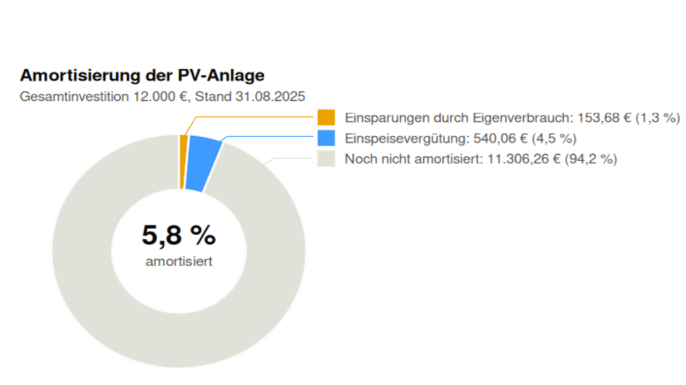

```{r setup, include=FALSE}
pak::pkg_install("here")
library(tidyverse)
```

```{r data_pipeline, message=FALSE, warning=FALSE, echo=FALSE}

# ---- Import: alle CSV-Dateien aus allen Zip-Dateien, jeder Wert wird als Text eingelesen -------

pv <- here::here("Projects/martin-raden/PV") |>                        #findet den Pfad zum Ordner mit den Zip-Dateien, das Paket this.path hat mit meiner R-Version nicht funktioniert # nolint: line_length_linter.
  list.files(pattern = "\\.zip$", full.names = TRUE, recursive = TRUE) |>  #findet alle Zip-Dateien im Ordner und in den Unterordnern
  map(function(zip) unzip(zip, list = TRUE) |>                             #Funktion, die den Inhalt jeder Zip-Datei auflistet
  transmute(zip = zip, file = Name)) |>
  list_rbind() |>                                                          #erstellt einen Data Frame mit dem Pfad der Zip-Datei und den Dateinamen darin
  # Deutsches CSV-Format (";" als Trennzeichen, "," als Dezimalzeichen). Die Spaltennamen kommen aus der Kopfzeile.
  mutate(data = map2(zip, file, function(zip_path, file_name)
    read_csv2(unz(zip_path, file_name), col_types = cols(.default = col_character())))) |>
  unnest(data) |>
  # Jede Datenzeile endet mit einem überzähligen ";" (z. B. "8,76;"), das readr an die letzte Spalte hängt.
  # Nur der Text vor dem ";" wird behalten.
  mutate(across(last_col(), function(x) str_extract(x, "^[^;]*"))) |>
  # Datumsangaben stehen als dd.mm.yyyy in den Dateien, Zahlen haben "," als Dezimalzeichen.
  mutate(Datum = dmy(Datum),
         across(-c(zip, file, Datum),
         function(x) parse_double(x, locale = locale(decimal_mark = ","))))

# ---- Doppelte Datumswerte (nur vollständige Zeilen, siehe "Datenintegrität" unten) ------------

duplicate_entries <- pv |>
  drop_na() |>
  filter(n() > 1, .by = Datum) |>
  arrange(Datum, file)

# ---- Bereinigung: 1. unvollständige Zeilen entfernen, 2. bei doppelten Datumswerten den höheren
# ----              PV-Ertrag behalten, 3. nur das Jahr 2025 behalten -----------------------------

pv_2025 <- pv |>
  drop_na() |>
  slice_max(`PV Ertrag [kWh]`, n = 1, by = Datum, with_ties = FALSE) |>
  filter(year(Datum) == 2025) |>
  arrange(Datum)

```

## 1. Import

Alle CSV-Dateien aus allen Zip-Dateien in `Projects/martin-raden/PV` wurden eingelesen und zu einer
Tabelle zusammengefügt: **`r nrow(pv)` Zeilen** aus **`r n_distinct(pv$file)` Dateien**, die den
Zeitraum `r format(min(pv$Datum), "%d.%m.%Y")` bis `r format(max(pv$Datum), "%d.%m.%Y")` abdecken.

## 2. Datenintegrität

### 2.1 Ist jeder Datensatz vollständig?

Es gibt **`r sum(is.na(pv))` fehlende Werte** in den `r ncol(pv) - 2` Datenspalten, daher sind
**`r nrow(pv) - nrow(drop_na(pv))` von `r nrow(pv)` Zeilen** unvollständig.

Fehlende Werte werden nicht ergänzt, da jede Zeile einer Tagesmessung entspricht und 
erfundene Werte die Ergebnisse verfälschen würde.

### 2.2 Gibt es doppelte Einträge?

Die Dateien decken überlappende Zeiträume ab (zum Beispiel endet eine Datei am 31.01. und die
nächste beginnt am 28.01.), daher kann dasselbe Datum in zwei Dateien vorkommen.

**`r n_distinct(duplicate_entries$Datum)` Datumswerte** kommen mehrfach vor (`r nrow(duplicate_entries)` Zeilen,
siehe unten). Der Eintrag mit dem höheren PV-Ertrag wird behalten, daher werden
**`r nrow(duplicate_entries) - n_distinct(duplicate_entries$Datum)` Zeilen entfernt**.

Beispielhafte doppelte Einträge:
```{r table_duplicates, echo=FALSE}

duplicate_entries |>
  transmute(Datum = format(Datum, "%d.%m.%Y"), Datei = file, `PV Ertrag [kWh]`) |>
  head(2) |>
  knitr::kable()

```

### 2.3 Nur das Jahr 2025

Entfernte Zeilen, weil sie nicht aus 2025 stammen: **`r pv |> drop_na() |> distinct(Datum) |> filter(year(Datum) != 2025) |> nrow()`**.

### 2.4 Ergebnis

Von **`r nrow(pv)` importierten Zeilen** wurden `r nrow(pv) - nrow(pv_2025)` entfernt. Die bereinigten Daten (`pv_2025`) enthalten **`r nrow(pv_2025)` Tagesdatensätze** vom
`r format(min(pv_2025$Datum), "%d.%m.%Y")` bis zum `r format(max(pv_2025$Datum), "%d.%m.%Y")`.

## 3. Datenaufbereitung

Vorschau der ersten Zeilen von `pv_2025`:

```{r table_preview, echo=FALSE}
# ---- Datenaufbereitung: Eigenverbrauch, Gesamtverbrauch und Eigenverbrauchsanteil berechnen ----

pv_more <- pv_2025 |>
  mutate(`Eigenverbrauch [kWh]` = `PV Ertrag [kWh]` - `Netzeinspeisung [kWh]` - `Speicherung [kWh]`,
         `Gesamtverbrauch [kWh]` = `Eigenverbrauch [kWh]` + `Netzbezug [kWh]`,
         `Eigenverbrauchsanteil [%]` = `Eigenverbrauch [kWh]` / `Gesamtverbrauch [kWh]` * 100) |>
  select(-zip, -file)

pv_more |>
  mutate(Datum = format(Datum, "%d.%m.%Y")) |>
  head(5) |>
  knitr::kable(digits = 2)

```

**Hinweis: An `r sum(pv_more[["Eigenverbrauch [kWh]"]] < 0)` von `r nrow(pv_more)` Tagen ist der berechnete
Eigenverbrauch negativ.** An diesen Tagen sind Netzeinspeisung und Speicherung zusammen größer als der
PV Ertrag. Das macht nicht so viel Sinn, da der Eigenverbrauch nicht negativ sein kann?

Für die weiteren Berechnungen werden diese Daten erstmal nicht entfernt, da sie im Datensatz vorkommen.

```{r table_negative, echo=FALSE}

pv_more |>
  filter(`Eigenverbrauch [kWh]` < 0) |>
  mutate(Datum = format(Datum, "%d.%m.%Y")) |>
  head(3) |>
  knitr::kable(digits = 2)

```

## 4. Datenanalyse and Visualisierung

### 4.1 Monatsübersicht

Kennzahlen pro Monat, mit den Annahmen Strompreis 0,30 €/kWh und Einspeisevergütung 0,08 €/kWh:

```{r table_monthly, echo=FALSE}
# ---- Datenanalyse: Kennzahlen pro Monat berechnen ----------------------------------------------

pv_analy <- pv_more |>
  group_by(Monat = month(Datum, label = TRUE)) |>
  summarise(across(c(`PV Ertrag [kWh]`, `Eigenverbrauch [kWh]`, `Gesamtverbrauch [kWh]`,
                     `Netzeinspeisung [kWh]`, `Netzbezug [kWh]`), sum)) |>
  # Annahmen: Strompreis 0,30 €/kWh, Einspeisevergütung 0,08 €/kWh
  mutate(`Stromkosten [€]` = `Netzbezug [kWh]` * 0.30,
         `Einspeisevergütung [€]` = `Netzeinspeisung [kWh]` * 0.08,
         `Einsparungen durch Eigenverbrauch [€]` = `Eigenverbrauch [kWh]` * 0.30,
         `Gesamtwirtschaftlichkeit [€]` = `Einsparungen durch Eigenverbrauch [€]` + `Einspeisevergütung [€]` - `Stromkosten [€]`)

pv_analy |>
  knitr::kable(digits = 2)

```

Wirtschaftlichkeit pro Monat:

```{r plot_monthly, echo=FALSE, fig.width=8, fig.height=5, fig.alt="Gruppiertes Balkendiagramm pro Monat: Stromkosten negativ, Einspeisevergütung und Einsparungen durch Eigenverbrauch gestapelt positiv, dazu eine Linie für die Gesamtwirtschaftlichkeit."}
# ---- Visualisierung: Kosten, Einnahmen und Gesamtwirtschaftlichkeit pro Monat -----------------

pv_analy |>
  select(Monat, `Einspeisevergütung [€]`, `Einsparungen durch Eigenverbrauch [€]`, `Stromkosten [€]`) |>
  mutate(`Stromkosten [€]` = -`Stromkosten [€]`) |>                       # Kosten als negative Werte
  pivot_longer(-Monat, names_to = "Kategorie", values_to = "Euro") |>    #Pivot_longer, damit jeder Monat drei Zeilen hat
  mutate(Kategorie = factor(str_remove(Kategorie, " \\[€\\]"), # Faktor, damit die Legende in der gewünschten Reihenfolge angezeigt wird
                            levels = c("Einspeisevergütung", "Einsparungen durch Eigenverbrauch", "Stromkosten"))) |>
  ggplot(aes(x = Monat, y = Euro)) +
  geom_hline(yintercept = 0, color = "#c3c2b7") +
  geom_col(aes(fill = Kategorie), width = 0.6, color = "#fcfcfb", linewidth = 0.6) +   # positive Werte gestapelt
  geom_line(data = pv_analy, aes(y = `Gesamtwirtschaftlichkeit [€]`, group = 1, color = "Gesamtwirtschaftlichkeit"),
            linewidth = 1) +
  geom_point(data = pv_analy, aes(y = `Gesamtwirtschaftlichkeit [€]`, color = "Gesamtwirtschaftlichkeit"),
             size = 3) +
  scale_fill_manual(values = c("Einspeisevergütung" = "#3f9bfd",
                               "Einsparungen durch Eigenverbrauch" = "#eda100",
                               "Stromkosten" = "#e34948")) +
  scale_color_manual(values = c("Gesamtwirtschaftlichkeit" = "#e019ea")) +
  scale_y_continuous(labels = scales::label_number(suffix = " €")) +
  labs(title = "Wirtschaftlichkeit der PV-Anlage pro Monat (2025)", x = NULL, y = NULL, fill = NULL, color = NULL) +
  theme_minimal() +
  theme(legend.position = "bottom",
        panel.grid.major.x = element_blank(), panel.grid.minor = element_blank(),
        panel.grid.major.y = element_line(color = "#e1e0d9"),
        plot.title = element_text(face = "bold"))

```

### 4.2 Jahresübersicht

Kennzahlen für die `r nrow(pv_more)` Tage von `r format(min(pv_more$Datum), "%d.%m.%Y")` bis
`r format(max(pv_more$Datum), "%d.%m.%Y")`:

```{r table_year, echo=FALSE}
# ---- Jahresübersicht: Kennzahlen für das gesamte Jahr 2025 -------------------------------------

pv_year <- bind_cols(
  # Summe über alle Monate aus der Monatstabelle
  pv_analy |>
    summarise(`Amortisierung [€]` = sum(`Einsparungen durch Eigenverbrauch [€]` + `Einspeisevergütung [€]`)),
  # Die restlichen Kennzahlen brauchen die Tageswerte
  # (Anteil der Tage = Anzahl der Tage, die die Bedingung erfüllen / Gesamtanzahl der Tage * 100)
  pv_more |>
    summarise(`Durchschnittlicher Netzbezug [kWh]` = mean(`Netzbezug [kWh]`),
              `Tage mit vollem Speicher [%]` = mean(`Speicherung [kWh]` < 0.5) * 100,
              `Tage mit überdurchschnittlichem Netzbezug [%]` = mean(`Netzbezug [kWh]` > mean(`Netzbezug [kWh]`) + sd(`Netzbezug [kWh]`)) * 100))

pv_year |>
  knitr::kable(digits = 2)

```

**Zusammenfassung:**

- **Hat sich die Investition schon amortisiert?** `r if (pv_year[["Amortisierung [€]"]] >= 12000) "Ja" else "Nein"`.
  Bisher wurden **`r round(pv_year[["Amortisierung [€]"]], 2)` €** eingespart bzw. durch Einspeisung eingenommen.
  Bei einer Gesamtinvestition von 12.000 € sind das **`r round(pv_year[["Amortisierung [€]"]] / 12000 * 100, 1)` %**.
- **Wie oft bin ich noch deutlich auf das Netz angewiesen?** An **`r round(pv_year[["Tage mit überdurchschnittlichem Netzbezug [%]"]], 2)` %**
  der Tage liegt der Netzbezug deutlich über dem Durchschnitt von `r round(pv_year[["Durchschnittlicher Netzbezug [kWh]"]], 2)` kWh pro Tag.
- **An wie vielen Tagen brauchte ich keinen Batteriespeicher?** An **`r round(pv_year[["Tage mit vollem Speicher [%]"]], 2)` %**
  der Tage wurden weniger als 0,5 kWh gespeichert.


### 4.3 Amortisierung

Anteile an der Gesamtinvestition von 12.000 €:

```{r plot_amortisation, echo=FALSE, fig.show='hide', fig.width=7, fig.height=5, fig.alt="Ringdiagramm der Gesamtinvestition von 12.000 Euro: kleine Anteile für die Einsparungen durch Eigenverbrauch und die Einspeisevergütung, der große Rest ist noch nicht amortisiert."}
# ---- Visualisierung: Amortisierung der Gesamtinvestition (12.000 €) ----------------------------

pv_analy |>
  summarise(`Einsparungen durch Eigenverbrauch` = sum(`Einsparungen durch Eigenverbrauch [€]`),
            Einspeisevergütung = sum(`Einspeisevergütung [€]`),
            `Noch nicht amortisiert` = 12000 - `Einsparungen durch Eigenverbrauch` - Einspeisevergütung) |>
  pivot_longer(everything(), names_to = "Kategorie", values_to = "Euro") |>
  # Beschriftung für die Legende: Name, Betrag und Anteil an der Investition
  mutate(Beschriftung = paste0(Kategorie, ": ", format(round(Euro, 2), big.mark = ".", decimal.mark = ",", nsmall = 2, trim = TRUE), " € (",
                               format(round(Euro / 12000 * 100, 1), decimal.mark = ",", trim = TRUE), " %)"),
         Beschriftung = factor(Beschriftung, levels = Beschriftung)) |>
  ggplot(aes(x = 2, y = Euro, fill = Beschriftung)) +
  geom_col(width = 1, color = "#fcfcfb", linewidth = 0.8, position = position_stack(reverse = TRUE)) +  # reverse: kleine Anteile beginnen oben
  coord_polar(theta = "y") +                                                                           # Balken wird zum Kreis
  xlim(c(0.4, 2.5)) +                                                                                  # Platz in der Mitte für das Loch
  annotate("text", x = 0.4, y = 0, size = 8, fontface = "bold", color = "#0b0b0b", lineheight = 1,
           label = paste0(format(round(pv_year[["Amortisierung [€]"]] / 12000 * 100, 1), decimal.mark = ","), " %\n")) +
  annotate("text", x = 0.4, y = 0, size = 4, color = "#52514e", label = "\namortisiert") +
  scale_fill_manual(values = c("#eda100", "#3f9bfd", "#e1e0d9")) +
  labs(title = "Amortisierung der PV-Anlage", subtitle = paste0("Gesamtinvestition 12.000 €, Stand ", format(max(pv_more$Datum), "%d.%m.%Y")), fill = NULL) +
  theme_void() +
  theme(legend.position = "bottom", legend.direction = "vertical",
        plot.title = element_text(face = "bold", color = "#0b0b0b", size = 14),
        plot.subtitle = element_text(color = "#52514e"), legend.text = element_text(color = "#52514e", size = 11),
        plot.margin = margin(10, 10, 10, 10))

```

<!-- Das Diagramm oben wird nicht angezeigt (fig.show='hide'). Stattdessen wird die nachbearbeitete Version eingebunden: -->

