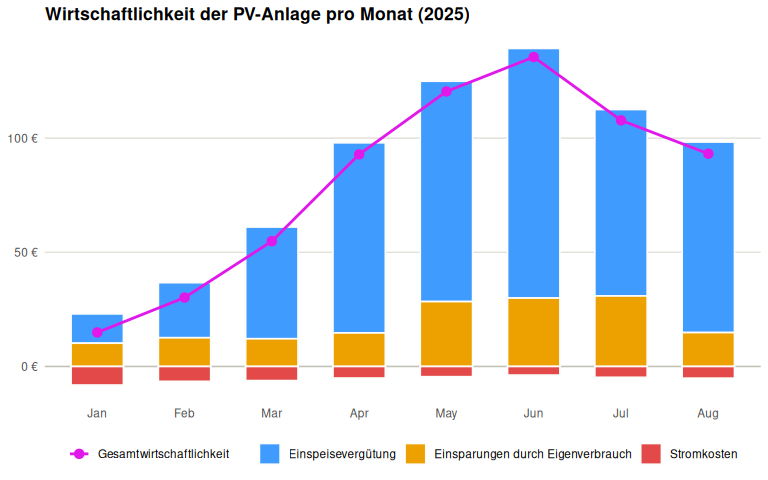
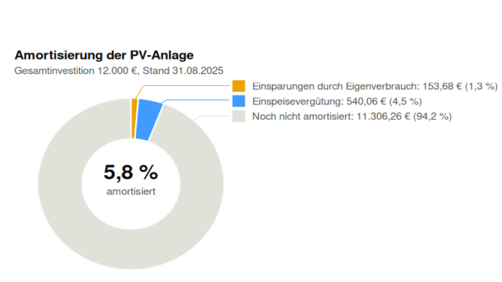

## 1. Import

Alle CSV-Dateien aus allen Zip-Dateien in `Projects/martin-raden/PV`
wurden eingelesen und zu einer Tabelle zusammengefügt: **251 Zeilen**
aus **8 Dateien**, die den Zeitraum 31.12.2024 bis 31.08.2025 abdecken.

## 2. Datenintegrität

### 2.1 Ist jeder Datensatz vollständig?

Es gibt **0 fehlende Werte** in den 5 Datenspalten, daher sind **0 von
251 Zeilen** unvollständig.

Fehlende Werte werden nicht ergänzt, da jede Zeile einer Tagesmessung
entspricht und erfundene Werte die Ergebnisse verfälschen würde.

### 2.2 Gibt es doppelte Einträge?

Die Dateien decken überlappende Zeiträume ab (zum Beispiel endet eine
Datei am 31.01. und die nächste beginnt am 28.01.), daher kann dasselbe
Datum in zwei Dateien vorkommen.

**9 Datumswerte** kommen mehrfach vor (18 Zeilen, siehe unten). Der
Eintrag mit dem höheren PV-Ertrag wird behalten, daher werden **9 Zeilen
entfernt**.

Beispielhafte doppelte Einträge:

<table>
<thead>
<tr>
<th style="text-align: left;">Datum</th>
<th style="text-align: left;">Datei</th>
<th style="text-align: right;">PV Ertrag [kWh]</th>
</tr>
</thead>
<tbody>
<tr>
<td style="text-align: left;">28.01.2025</td>
<td style="text-align: left;">2024-12-31_2025-01-31_127120425.csv</td>
<td style="text-align: right;">6.96</td>
</tr>
<tr>
<td style="text-align: left;">28.01.2025</td>
<td style="text-align: left;">2025-01-28_2025-02-28_127120425.csv</td>
<td style="text-align: right;">6.96</td>
</tr>
</tbody>
</table>

### 2.3 Nur das Jahr 2025

Entfernte Zeilen, weil sie nicht aus 2025 stammen: **1**.

### 2.4 Ergebnis

Von **251 importierten Zeilen** wurden 10 entfernt. Die bereinigten
Daten (`pv_2025`) enthalten **241 Tagesdatensätze** vom 01.01.2025 bis
zum 31.08.2025.

## 3. Datenaufbereitung

Vorschau der ersten Zeilen von `pv_2025`:

<table>
<colgroup>
<col style="width: 7%" />
<col style="width: 14%" />
<col style="width: 10%" />
<col style="width: 11%" />
<col style="width: 10%" />
<col style="width: 13%" />
<col style="width: 14%" />
<col style="width: 17%" />
</colgroup>
<thead>
<tr>
<th style="text-align: left;">Datum</th>
<th style="text-align: right;">Netzeinspeisung [kWh]</th>
<th style="text-align: right;">Netzbezug [kWh]</th>
<th style="text-align: right;">Speicherung [kWh]</th>
<th style="text-align: right;">PV Ertrag [kWh]</th>
<th style="text-align: right;">Eigenverbrauch [kWh]</th>
<th style="text-align: right;">Gesamtverbrauch [kWh]</th>
<th style="text-align: right;">Eigenverbrauchsanteil [%]</th>
</tr>
</thead>
<tbody>
<tr>
<td style="text-align: left;">01.01.2025</td>
<td style="text-align: right;">13.19</td>
<td style="text-align: right;">0.62</td>
<td style="text-align: right;">0.99</td>
<td style="text-align: right;">14.34</td>
<td style="text-align: right;">0.16</td>
<td style="text-align: right;">0.78</td>
<td style="text-align: right;">20.51</td>
</tr>
<tr>
<td style="text-align: left;">02.01.2025</td>
<td style="text-align: right;">0.12</td>
<td style="text-align: right;">1.18</td>
<td style="text-align: right;">1.43</td>
<td style="text-align: right;">1.91</td>
<td style="text-align: right;">0.36</td>
<td style="text-align: right;">1.54</td>
<td style="text-align: right;">23.38</td>
</tr>
<tr>
<td style="text-align: left;">03.01.2025</td>
<td style="text-align: right;">2.89</td>
<td style="text-align: right;">0.92</td>
<td style="text-align: right;">6.45</td>
<td style="text-align: right;">10.27</td>
<td style="text-align: right;">0.93</td>
<td style="text-align: right;">1.85</td>
<td style="text-align: right;">50.27</td>
</tr>
<tr>
<td style="text-align: left;">04.01.2025</td>
<td style="text-align: right;">7.09</td>
<td style="text-align: right;">0.70</td>
<td style="text-align: right;">4.09</td>
<td style="text-align: right;">13.17</td>
<td style="text-align: right;">1.99</td>
<td style="text-align: right;">2.69</td>
<td style="text-align: right;">73.98</td>
</tr>
<tr>
<td style="text-align: left;">05.01.2025</td>
<td style="text-align: right;">0.13</td>
<td style="text-align: right;">1.21</td>
<td style="text-align: right;">4.35</td>
<td style="text-align: right;">5.05</td>
<td style="text-align: right;">0.57</td>
<td style="text-align: right;">1.78</td>
<td style="text-align: right;">32.02</td>
</tr>
</tbody>
</table>

**Hinweis: An 15 von 241 Tagen ist der berechnete Eigenverbrauch
negativ.** An diesen Tagen sind Netzeinspeisung und Speicherung zusammen
größer als der PV Ertrag. Das macht nicht so viel Sinn, da der
Eigenverbrauch nicht negativ sein kann?

Für die weiteren Berechnungen werden diese Daten erstmal nicht entfernt,
da sie im Datensatz vorkommen.

<table>
<colgroup>
<col style="width: 7%" />
<col style="width: 14%" />
<col style="width: 10%" />
<col style="width: 11%" />
<col style="width: 10%" />
<col style="width: 13%" />
<col style="width: 14%" />
<col style="width: 17%" />
</colgroup>
<thead>
<tr>
<th style="text-align: left;">Datum</th>
<th style="text-align: right;">Netzeinspeisung [kWh]</th>
<th style="text-align: right;">Netzbezug [kWh]</th>
<th style="text-align: right;">Speicherung [kWh]</th>
<th style="text-align: right;">PV Ertrag [kWh]</th>
<th style="text-align: right;">Eigenverbrauch [kWh]</th>
<th style="text-align: right;">Gesamtverbrauch [kWh]</th>
<th style="text-align: right;">Eigenverbrauchsanteil [%]</th>
</tr>
</thead>
<tbody>
<tr>
<td style="text-align: left;">04.03.2025</td>
<td style="text-align: right;">33.64</td>
<td style="text-align: right;">0.52</td>
<td style="text-align: right;">0.77</td>
<td style="text-align: right;">34.25</td>
<td style="text-align: right;">-0.16</td>
<td style="text-align: right;">0.36</td>
<td style="text-align: right;">-44.44</td>
</tr>
<tr>
<td style="text-align: left;">14.03.2025</td>
<td style="text-align: right;">12.53</td>
<td style="text-align: right;">1.13</td>
<td style="text-align: right;">3.28</td>
<td style="text-align: right;">6.84</td>
<td style="text-align: right;">-8.97</td>
<td style="text-align: right;">-7.84</td>
<td style="text-align: right;">114.41</td>
</tr>
<tr>
<td style="text-align: left;">20.03.2025</td>
<td style="text-align: right;">30.12</td>
<td style="text-align: right;">0.70</td>
<td style="text-align: right;">3.26</td>
<td style="text-align: right;">33.01</td>
<td style="text-align: right;">-0.37</td>
<td style="text-align: right;">0.33</td>
<td style="text-align: right;">-112.12</td>
</tr>
</tbody>
</table>

## 4. Datenanalyse and Visualisierung

### 4.1 Monatsübersicht

Kennzahlen pro Monat, mit den Annahmen Strompreis 0,30 €/kWh und
Einspeisevergütung 0,08 €/kWh:

<table>
<colgroup>
<col style="width: 2%" />
<col style="width: 7%" />
<col style="width: 10%" />
<col style="width: 10%" />
<col style="width: 10%" />
<col style="width: 7%" />
<col style="width: 7%" />
<col style="width: 11%" />
<col style="width: 18%" />
<col style="width: 13%" />
</colgroup>
<thead>
<tr>
<th style="text-align: left;">Monat</th>
<th style="text-align: right;">PV Ertrag [kWh]</th>
<th style="text-align: right;">Eigenverbrauch [kWh]</th>
<th style="text-align: right;">Gesamtverbrauch [kWh]</th>
<th style="text-align: right;">Netzeinspeisung [kWh]</th>
<th style="text-align: right;">Netzbezug [kWh]</th>
<th style="text-align: right;">Stromkosten [€]</th>
<th style="text-align: right;">Einspeisevergütung [€]</th>
<th style="text-align: right;">Einsparungen durch Eigenverbrauch
[€]</th>
<th style="text-align: right;">Gesamtwirtschaftlichkeit [€]</th>
</tr>
</thead>
<tbody>
<tr>
<td style="text-align: left;">Jan</td>
<td style="text-align: right;">313.43</td>
<td style="text-align: right;">33.97</td>
<td style="text-align: right;">61.07</td>
<td style="text-align: right;">160.42</td>
<td style="text-align: right;">27.10</td>
<td style="text-align: right;">8.13</td>
<td style="text-align: right;">12.83</td>
<td style="text-align: right;">10.19</td>
<td style="text-align: right;">14.89</td>
</tr>
<tr>
<td style="text-align: left;">Feb</td>
<td style="text-align: right;">436.24</td>
<td style="text-align: right;">41.92</td>
<td style="text-align: right;">63.64</td>
<td style="text-align: right;">301.50</td>
<td style="text-align: right;">21.72</td>
<td style="text-align: right;">6.52</td>
<td style="text-align: right;">24.12</td>
<td style="text-align: right;">12.58</td>
<td style="text-align: right;">30.18</td>
</tr>
<tr>
<td style="text-align: left;">Mar</td>
<td style="text-align: right;">728.74</td>
<td style="text-align: right;">40.43</td>
<td style="text-align: right;">61.06</td>
<td style="text-align: right;">611.56</td>
<td style="text-align: right;">20.63</td>
<td style="text-align: right;">6.19</td>
<td style="text-align: right;">48.92</td>
<td style="text-align: right;">12.13</td>
<td style="text-align: right;">54.86</td>
</tr>
<tr>
<td style="text-align: left;">Apr</td>
<td style="text-align: right;">1145.89</td>
<td style="text-align: right;">48.96</td>
<td style="text-align: right;">65.89</td>
<td style="text-align: right;">1040.88</td>
<td style="text-align: right;">16.93</td>
<td style="text-align: right;">5.08</td>
<td style="text-align: right;">83.27</td>
<td style="text-align: right;">14.69</td>
<td style="text-align: right;">92.88</td>
</tr>
<tr>
<td style="text-align: left;">May</td>
<td style="text-align: right;">1343.54</td>
<td style="text-align: right;">94.70</td>
<td style="text-align: right;">109.63</td>
<td style="text-align: right;">1206.39</td>
<td style="text-align: right;">14.93</td>
<td style="text-align: right;">4.48</td>
<td style="text-align: right;">96.51</td>
<td style="text-align: right;">28.41</td>
<td style="text-align: right;">120.44</td>
</tr>
<tr>
<td style="text-align: left;">Jun</td>
<td style="text-align: right;">1500.56</td>
<td style="text-align: right;">99.88</td>
<td style="text-align: right;">112.46</td>
<td style="text-align: right;">1366.43</td>
<td style="text-align: right;">12.58</td>
<td style="text-align: right;">3.77</td>
<td style="text-align: right;">109.31</td>
<td style="text-align: right;">29.96</td>
<td style="text-align: right;">135.50</td>
</tr>
<tr>
<td style="text-align: left;">Jul</td>
<td style="text-align: right;">1186.49</td>
<td style="text-align: right;">102.94</td>
<td style="text-align: right;">118.76</td>
<td style="text-align: right;">1020.63</td>
<td style="text-align: right;">15.82</td>
<td style="text-align: right;">4.75</td>
<td style="text-align: right;">81.65</td>
<td style="text-align: right;">30.88</td>
<td style="text-align: right;">107.79</td>
</tr>
<tr>
<td style="text-align: left;">Aug</td>
<td style="text-align: right;">1154.59</td>
<td style="text-align: right;">49.48</td>
<td style="text-align: right;">66.55</td>
<td style="text-align: right;">1042.92</td>
<td style="text-align: right;">17.07</td>
<td style="text-align: right;">5.12</td>
<td style="text-align: right;">83.43</td>
<td style="text-align: right;">14.84</td>
<td style="text-align: right;">93.16</td>
</tr>
</tbody>
</table>

Wirtschaftlichkeit pro Monat:

### 4.2 Jahresübersicht

Kennzahlen für die 241 Tage von 01.01.2025 bis 31.08.2025:

<table>
<colgroup>
<col style="width: 14%" />
<col style="width: 27%" />
<col style="width: 22%" />
<col style="width: 35%" />
</colgroup>
<thead>
<tr>
<th style="text-align: right;">Amortisierung [€]</th>
<th style="text-align: right;">Durchschnittlicher Netzbezug [kWh]</th>
<th style="text-align: right;">Tage mit vollem Speicher [%]</th>
<th style="text-align: right;">Tage mit überdurchschnittlichem Netzbezug
[%]</th>
</tr>
</thead>
<tbody>
<tr>
<td style="text-align: right;">693.74</td>
<td style="text-align: right;">0.61</td>
<td style="text-align: right;">7.05</td>
<td style="text-align: right;">17.84</td>
</tr>
</tbody>
</table>

**Zusammenfassung:**

- **Hat sich die Investition schon amortisiert?** Nein. Bisher wurden
  **693.74 €** eingespart bzw. durch Einspeisung eingenommen. Bei einer
  Gesamtinvestition von 12.000 € sind das **5.8 %**.
- **Wie oft bin ich noch deutlich auf das Netz angewiesen?** An **17.84
  %** der Tage liegt der Netzbezug deutlich über dem Durchschnitt von
  0.61 kWh pro Tag.
- **An wie vielen Tagen brauchte ich keinen Batteriespeicher?** An
  **7.05 %** der Tage wurden weniger als 0,5 kWh gespeichert.

### 4.3 Amortisierung

Anteile an der Gesamtinvestition von 12.000 €:

<!-- Das Diagramm oben wird nicht angezeigt (fig.show='hide'). Stattdessen wird die nachbearbeitete Version eingebunden: -->

<figure>

<figcaption aria-hidden="true">Ringdiagramm der Amortisierung: 5,8 % der
Gesamtinvestition von 12.000 € sind amortisiert, aufgeteilt in
Einsparungen durch Eigenverbrauch und Einspeisevergütung.</figcaption>
</figure>
